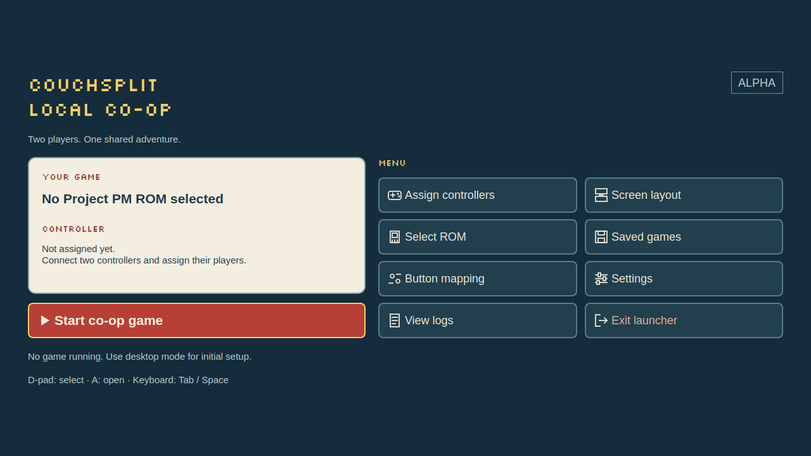
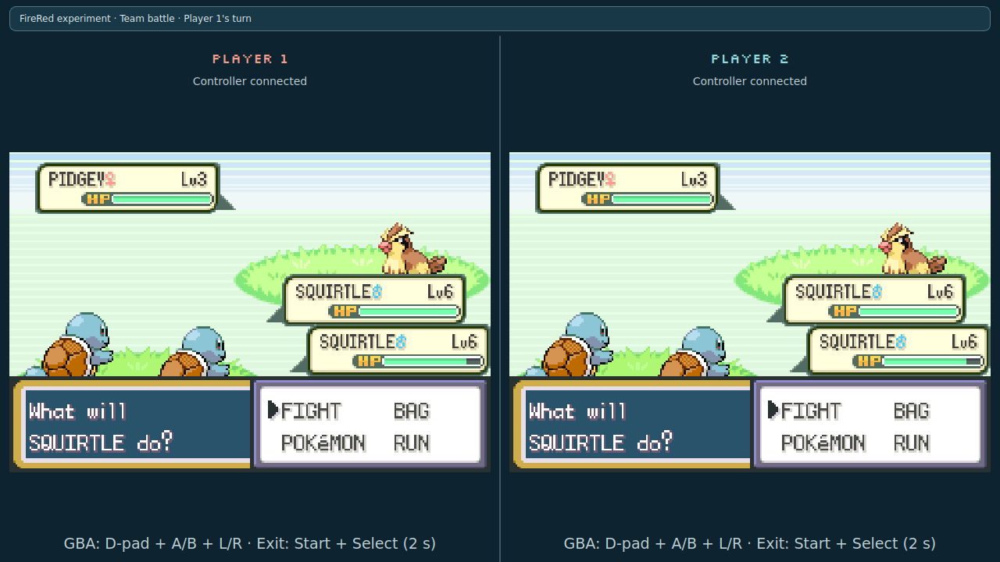
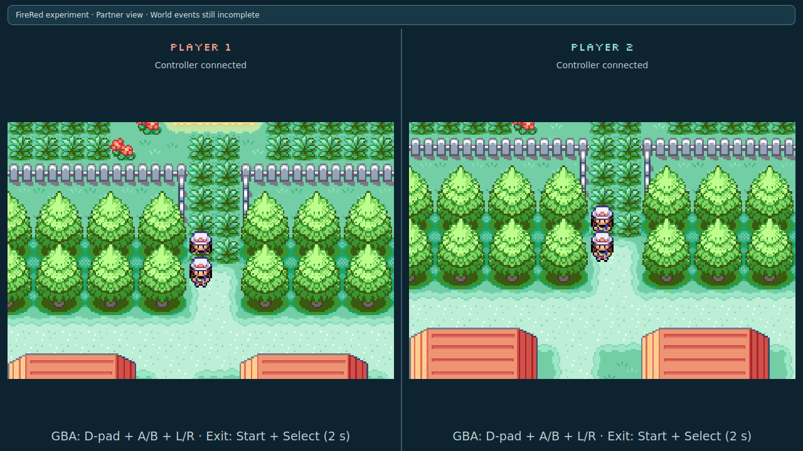
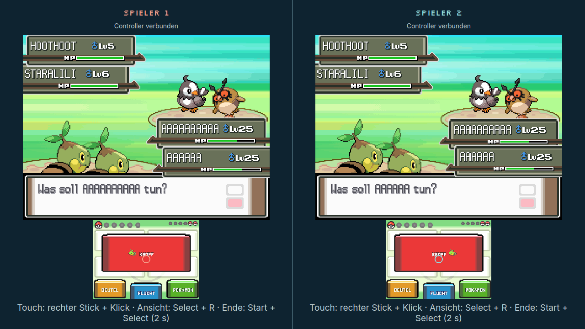
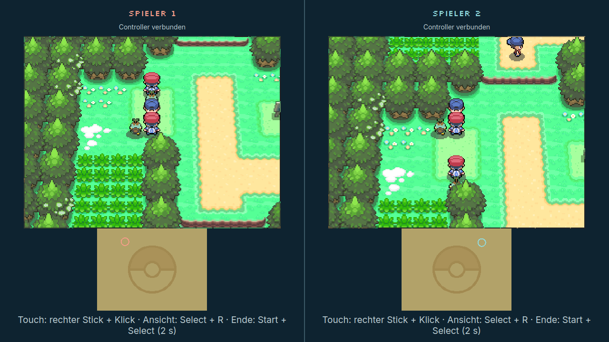
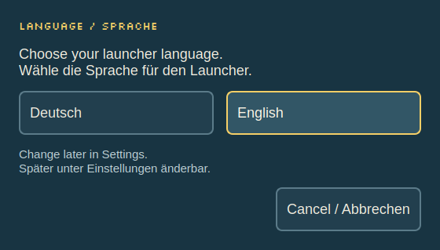
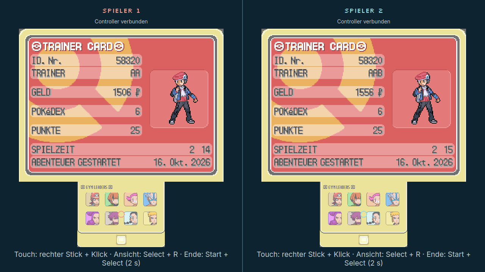

<div align="center">

# CouchSplit

**Two players. One couch. One shared screen.**

A split-screen couch co-op launcher for Windows and Linux.

**Project PM / Pokémon Platinum · GBA split screen · experimental FireRed co-op**

**Alpha 12 adds English FireRed 1.0 and 1.1 co-op.** See your partner, choose
your own actions in shared battles, and keep separate teams, bags and saves.
The exact German original remains supported. FireRed co-op is experimental;
[setup, supported cartridges and test limits](docs/firered-english-profiles.md).

[](https://github.com/Philmenting/couchsplit/releases/tag/v0.2.0-alpha.12)
[](https://github.com/Philmenting/couchsplit/actions/workflows/platforms.yml)
[](LICENSE)

[Game modes](#game-modes) · [Download](#download) · [Get started](#get-started-with-project-pm) · [Screenshots](#project-pm-play-together) · [Test status](#what-has-been-tested) · [Deutsch](#deutsch)



</div>

## Game modes

| Game | Available in | Experience |
|---|---|---|
| Project PM / Pokémon Platinum | Alpha 12 | Local co-op with a compatible Project PM ROM. |
| GBA games and ROM hacks | Alpha 12 | Two independent games in split screen; compatibility varies. |
| German Pokémon FireRed | Alpha 12, opt-in | Experimental partner display, shared battles and selected shared story progress. |
| English Pokémon FireRed 1.0 / 1.1 | Alpha 12, opt-in | The same experimental co-op through separately verified cartridge profiles. |

FireRed's partner display covers the same map and directly connected outdoor
maps; a shared battle requires both players to be ready on the same map.
Partner collision and full campaign coverage are not established. EXP Share awards
can reach all twelve owned Pokémon; a held Enigma Berry pauses both games with an
explicit option to continue individual battles; [read the known limits](docs/firered.md) and
save both games regularly. GBA link multiplayer is not implemented.

## Help test Alpha 12

We are looking for Windows and Bazzite testers. [Try the short playtest and report what works](docs/testing.md) — installation reports are welcome, and no full playthrough is required. [Deutsch](docs/de/testing.md).

## Download

**[Get 0.2.0 Alpha 12](https://github.com/Philmenting/couchsplit/releases/tag/v0.2.0-alpha.12)** — English and German experimental FireRed co-op, GBA split screen and independent saves.

| Your system | Download | Start here |
|---|---|---|
| **Windows 10/11 · x64** | [Installer (.exe)](https://github.com/Philmenting/couchsplit/releases/download/v0.2.0-alpha.12/CouchSplit-Windows-Setup.exe) · [Portable ZIP](https://github.com/Philmenting/couchsplit/releases/download/v0.2.0-alpha.12/CouchSplit-Windows-Portable.zip) | Install, or fully extract the ZIP and open `Start.bat`. |
| **Bazzite · x86_64** | [Installer (.run)](https://github.com/Philmenting/couchsplit/releases/download/v0.2.0-alpha.12/CouchSplit-Bazzite.run) | Run from desktop mode after marking it executable. Uses its own Distrobox runtime. |
| **Zorin OS 18 / Ubuntu 24.04 · x86_64** | [Debian package (.deb)](https://github.com/Philmenting/couchsplit/releases/download/v0.2.0-alpha.12/CouchSplit-ZorinOS18-amd64.deb) | Install through your software manager. |

[Checksums](https://github.com/Philmenting/couchsplit/releases/download/v0.2.0-alpha.12/SHA256SUMS) · [ROM correction tools](https://github.com/Philmenting/couchsplit/releases/download/v0.2.0-alpha.12/Pokemon-PM-ROM-Korrekturen.zip) · [Release notes](docs/releases/v0.2.0-alpha.12.md) · [Platform guide](docs/platforms.md)

You need **two controllers and your own compatible ROM**: a Project-PM-patched Platinum ROM for DS co-op, or a GBA game for GBA split screen. FireRed co-op accepts only the exact supported English 1.0/1.1 or German originals. No games, Nintendo BIOS, proprietary firmware or user saves are included. The launcher does not add world co-op to an unmodified Platinum ROM. All packages are alpha releases. Choose **English or Deutsch** at first launch; change it later in **Settings / Einstellungen**. This does not change the language of your game ROM.

## English FireRed: play together





*Captured in the real Linux launcher and paired worker using English FireRed 1.1,
prepared demo saves and virtual controllers. Both players chose their own actions;
both saved in-game and continued after restarting. These short tests do not certify
a complete campaign or physical-controller gameplay on Windows/Bazzite.
[Capture evidence](docs/verification/firered-english-capture-2026-11-10.json) ·
[Screenshot origins](docs/images/README.md#english-firered-alpha-12)*

## Project PM: play together

Two separate Project PM/melonDS processes share one window. Each player controls their own game and keeps their own save. The launcher handles controller assignment, screen layout, the local connection and orderly shutdown.



*An actual trainer battle on Linux with virtual SDL controllers. This targeted healing test uses separate copied saves with a prepared level-25 team. It is not a mockup or evidence of physical-controller or Windows gameplay testing.*



*Two views of the same route, directly after victory and before any movement. Both players' own followers are visible. [Screenshot origins and test context](docs/images/README.md).*

### Built for a shared screen

- **One window, multiple layouts:** players side by side or stacked; large top screen with a smaller touch screen, adjacent DS screens, or a switchable single-screen view.
- **Independent input:** explicit controller assignment, remappable DS buttons and right-stick touch control. Game inputs are neutral while the launcher menu is open.
- **Separate progress:** player/ROM-specific profiles, backups before each start and verified backup restoration.
- **Local connection:** a direct loopback host/client bridge, with no public relay or port forwarding.
- **English and German:** choose at first launch, switch later in Settings without restarting a running session.
- **A readable retro menu:** pixel headings, native body text, visible keyboard/controller focus and layouts that scale from small windows to 4K.

## Get started with Project PM



1. **Install your platform package and choose your language.** At first launch, select **English** or **Deutsch**. Use desktop mode for initial setup. Bazzite needs Distrobox/Podman, internet access and about 3 GiB of free space for its runtime.
2. **Select a prepared ROM.** Use **Select ROM / ROM auswählen** to add a compatible `.nds` or ROM ZIP. [PM 0.4.5 requirements](docs/project-pm-045.md) · [German localization](docs/german-localization.md).
3. **Assign two controllers.** Open **Assign controllers / Controller zuordnen**, assign players 1/2 and choose your screen layout under **Screen layout / Bildschirmaufteilung**.
4. **Enable co-op in the game.** Select **Start co-op game / Koop-Spiel starten**. PM 0.4.5 unlocks Wireless Play after receiving the Pokédex; shared trainer battles also require the in-game co-op setting.
5. **Save normally.** Each player saves their own progress in the game. Then end the session together.

| Input | Action |
|---|---|
| Left stick / D-pad | Move |
| Right stick + stick click | Move and press the touch cursor |
| Select + R | Switch the single-screen view |
| Start + Select · hold 2 seconds | Stop both emulators cleanly |
| Escape | Open launcher menu; **Start co-op game / Koop-Spiel starten** resumes the session |
| Tab / Space | Navigate and activate launcher menu actions |

If Steam produces duplicate inputs, disable Steam Input **for this game entry**. Bazzite requests its Steam entry through the host helper; the application-menu action can retry if it is missing. [Bazzite setup](docs/one-file-installer.md) · [Troubleshooting](docs/troubleshooting.md). Detailed guides are available in [English](docs/README.md) and [German](docs/de/README.md).

To try FireRed, install Alpha 12 and enable **Settings → FireRed co-op (experimental)** as
described in the [FireRed guide](docs/firered.md) or [Bazzite test guide](docs/bazzite-firered-test.md).

### ROM corrections and existing saves

Separate tools correct two reproduced bugs in the **exact verified German PM 0.4.5 ROM**: [target selection after an opponent faints](docs/rom-target-cursor-fix.md), followed by [HP synchronization after Potions](docs/rom-coop-item-fix.md). They check the input, overlay and result against fixed fingerprints and create a new ROM copy. Updating the launcher does not automatically apply a ROM correction.

**A new ROM fingerprint gets separate save directories.** Previous profiles remain intact and are not automatically merged. Back up both players' saves before switching. [Explicit save-transfer instructions](docs/save-transfer.md).

## What has been tested?

| Area | Evidence |
|---|---|
| Linux and Windows | Native builds, controller/session/UI tests, two real emulator processes and package/installation checks in [GitHub Actions](https://github.com/Philmenting/couchsplit/actions/workflows/platforms.yml). ROM-free smoke tests use our own homebrew. |
| Language selection | Native UI tests cover both languages, first launch, saved choice, cancellation, existing profiles, write failures and switching during a running fixture session; compact windows through 4K. |
| Actual Pokémon co-op | On Linux: shared-world views, movement, wild/trainer battles and independent commands. Virtual SDL controllers; no physical-hardware certification. |
| ROM battle corrections | Actual before/after gameplay checks, plus ARM instruction tests on Linux and Windows. [Technical results](docs/verification/coop-item-sync-2026-10-19.json). |
| Money and saving | In the tested shared victory over Sven, **each player receives 96 ₽**. Both balances and victory flags survive normal saving and a fresh launch. |
| Experimental FireRed | Alpha 12 adds [40 targeted English/German original-ROM checks](docs/verification/firered-english-2026-11-10.json), plus an English production-session save/restart capture. Linux original-ROM checks cover twelve EXP Share recipients, owned learning/evolutions, full-party switches, native map refresh and a repeated production-session test. Authored checkpoints and virtual controllers; no continuous campaign claim. [Alpha 9 sustained evidence](docs/verification/firered-alpha9-2026-11-08.json) · [Alpha 10 ownership checks](docs/verification/firered-alpha10-2026-11-08.json) · [Alpha 11 runtime checks](docs/verification/firered-reserves-2026-11-08.json). |

<details>
<summary>See both trainer cards after restarting</summary>



+96 ₽ each: 1,410 → 1,506 and 1,460 → 1,556. The targeted victory test uses prepared level-25 team copies; wallet, inventory, story and trainer-victory flags were not edited during that preparation. The measured reward applies to this battle.

</details>

Still pending: physical controllers, actual Windows/Bazzite Pokémon gameplay, KDE Wayland/Gamescope on target hardware, trading, a complete German playthrough and multi-hour sessions. [Development status](docs/development-status.md) · [Manual acceptance tests](docs/acceptance-tests.md).

## Development and documentation

C++17, CMake, Qt 6 and SDL2; see the [build guide](docs/bazzite-installation.md) for dependencies. The script checks out the pinned upstream and applies our patches.

```bash
scripts/build.sh
python3 -m unittest discover -s tests -p 'test_*.py'
```

For all ARM tests, also install `tests/requirements-romfix.txt`; decoder tests require `xdelta3`. Output: `build/bin/platinum-coop`, `build/bin/melonDS-coop` and `build/bin/gba-worker`. There is no verified universal AppImage; Bazzite uses its own runtime. Emulator packages include matching GPL source, including the pinned, patched upstream.

[Architecture](docs/architecture.md) · [Platforms](docs/platforms.md) · [ROM preparation](docs/project-pm-045.md) · [Localization](docs/german-localization.md) · [Report a bug](https://github.com/Philmenting/couchsplit/issues/new)

## Deutsch

**Alpha 12 unterstützt englisches Feuerrot 1.0 und 1.1 sowie das deutsche Original.**
Der experimentelle Koop zeigt den Partner, ermöglicht gemeinsame Kämpfe mit eigenen
Eingaben und erhält getrennte Teams, Taschen und Spielstände.
[Einrichtung, Fingerabdrücke und Prüfgrenzen](docs/de/firered-english-profiles.md).

**CouchSplit** bringt Couch-Koop und Splitscreen in ein gemeinsames Fenster.
Project PM / Pokémon Platin sowie getrennte GBA-Spiele bleiben enthalten.
**[Alpha 12 herunterladen](https://github.com/Philmenting/couchsplit/releases/tag/v0.2.0-alpha.12)**
für Windows, Bazzite oder Zorin OS 18 / Ubuntu 24.04, die eigene kompatible ROM
wählen und zwei Controller zuordnen. Feuerrot-Koop unter
**Einstellungen → Feuerrot-Koop (experimentell)** aktivieren.
Die Launcher-Sprache ist unabhängig von der Spielsprache.
[Deutsche Anleitungen](docs/de/README.md) · [Englische Anleitungen](docs/README.md).

Welt-Koop und gemeinsame Kämpfe wurden unter Linux mit virtuellen SDL-Controllern geprüft. Windows-/Linux-CI prüft Builds, native Tests und Pakete. Gezielte Heilungs-/Siegszenarien nutzen vorbereitete Level-25-Spielstandkopien. Physische Hardware und ein vollständiger Durchlauf bleiben offen. ROM-Korrekturen sind separate, hashgebundene Werkzeuge; ein neuer ROM-Hash verwendet eigene Spielstandordner. [Spielstände übernehmen](docs/de/save-transfer.md) · [Einrichtung](docs/de/platforms.md).

## Credits and license

Our launcher and changes: **[GPL-3.0-or-later](LICENSE)**. [Project PM / platinum-mp](https://github.com/ComicartOlie/melonDS-Project-PM/tree/platinum-mp) provides the DS emulator core, ROM mailbox bridge and SaveManager, based on [melonDS](https://github.com/melonDS-emu/melonDS). The GBA worker embeds [mGBA 0.10.5](https://github.com/mgba-emu/mgba/tree/0.10.5), licensed under MPL-2.0; matching source and licenses accompany distributed workers. Silkscreen uses the [SIL Open Font License](assets/fonts/OFL.txt). mGBA SplitScreen and CouchPlay were architectural references; no code was taken from them.

An unofficial project, not affiliated with Nintendo, Game Freak or The Pokémon Company. Game screenshots document the tests; game-content rights remain with their respective owners.
