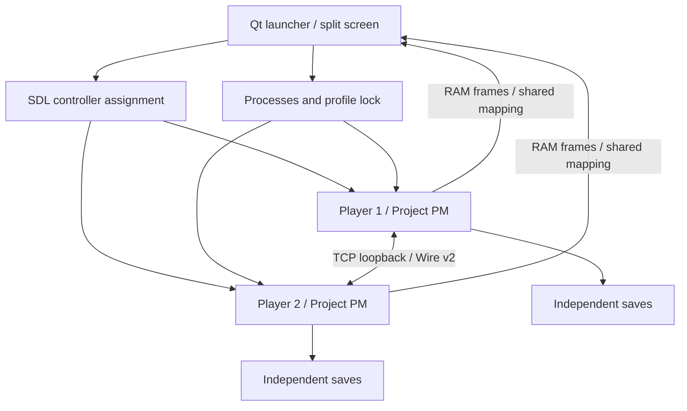

# Architecture

**English** · [Deutsch](de/architecture.md) · [Documentation](README.md)

The launcher is a C++17/Qt 6 application connecting existing emulator functionality to a small IPC interface. Each independent emulator retains its own EmuInstance, EmuThread, DS hardware, audio and SaveManager. The original Linux mapping implementation has a native Windows counterpart in the current packages.

| Module | Implementation | Responsibility |
|---|---|---|
| Emulator manager | `launcher/Session.h` | QProcess, capability validation, failure monitoring and cooperative shutdown; Linux SIGTERM/parent-death handling and Windows job ownership |
| Session transport | Project PM patch + `multiplayer/SocketCompat.h` | Actual TCP bridge, localhost, POSIX adaptation, roles and reconnect |
| Controller manager | `controller/Controllers.h` | SDL GameController, live instance IDs, neutral input on disconnect, stick touch and mappings |
| Display | `display/Layout.h`, `display/CoopIPC.h`, PlayView | 4:3 geometry, mapped RAM frames, shared Qt surface and cursors |
| Save manager | `saves/SaveStore.h` + melonDS SaveManager | Profile lock, SHA-256 backup/restore; the emulator performs actual in-game saving |
| Launcher UI | `launcher/main.cpp` | Setup, session menu, TV layout and logs |

## Why one rendering surface?

CouchPlay controls KDE with temporary KWin scripts, nested Gamescope and privileged device isolation. KWin is not generally available in Steam Gaming Mode, and Wayland does not permit general positioning of other applications' windows. X11 embedding would not be native Wayland either. melonDS's existing software renderer already supplies both framebuffers; painting them directly in one Qt window avoids external window control or a custom compositor.

The baseline renderer remains **software-based**, at DS resolution 256 × 192 per screen. Qt scales the output. Hardware-accelerated DS 3D upscaling textures are not transported. Image quality and performance on the target PC still need hardware testing.

## IPC and input

On Linux each session has a random temporary directory with mode 0700. Mapping files use mode 0600, O_EXCL/O_NOFOLLOW and checked size/ABI. Lock-free 32-bit atomics carry buttons, touch and status. A try-lock protects frame copies; occupied frames are skipped so the game continues. If a process crashes during copying, monitoring stops the session and removes the mappings. Windows uses native file mappings with the same shared ABI.

SDL reads controllers only in the launcher. In IPC mode workers set their DS KeyMask directly from their own mapping and ignore ordinary keyboard/controller input. Disconnecting Bluetooth produces neutral input; a new SDL instance must be explicitly assigned again. A GUID is not a unique physical identity, particularly for identical devices without serial numbers.

## Network

The launcher selects a free local TCP port and passes it to both workers. `PMCOOP_ROLE` makes Project PM host on `127.0.0.1`; the client connects there. Discovery broadcast and online relay are disabled in local mode. The short gap between releasing the chosen port and host bind remains a possible race; failures are visible in status/logs. This is local transport.

Wire v2 uses `u16 LE length` plus payload; bridge tags 1 (block/overworld), 2 (party), 3 (packet); control frames 0xFF (role), 0xFE (name), 0xFD/0xFC (ping/pong). The ROM must publish discovery/control blocks and activate its multiplayer mode. A socket peer and active ROM control byte do not establish world synchronization.

## Saves and lifecycle

On Linux the default root is `$XDG_DATA_HOME/pokemon-platinum-local-coop` or `~/.local/share/pokemon-platinum-local-coop`; see [platforms](platforms.md) for Windows. Each player and ROM SHA-256 has its own profile, preventing shared writes and collisions between identically named ROMs. A different patch/hash gets a new profile; transferring existing saves is an [explicit operation](save-transfer.md).

QLockFile locks the data root for the session. The launcher backs up `*.sav` before starting and writes metadata atomically. Restore validates the complete manifest and first backs up the current state. Backups are not deleted automatically. Graceful shutdown lets upstream EmuInstance/SaveManager finish cleanup. Forced SIGKILL can lose unsaved progress. Crashed games are never restarted automatically.
